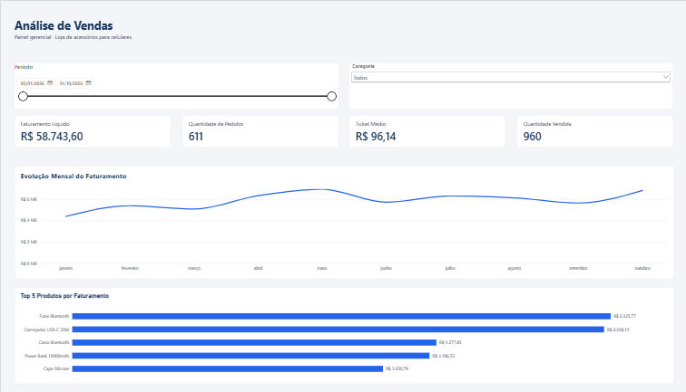

# Dashboard de Análise de Vendas | Power BI

**Projeto demonstrativo de Business Intelligence para análise de desempenho comercial de uma loja de acessórios para celulares.**

## Sobre o projeto

Este projeto apresenta uma solução de Business Intelligence desenvolvida com Microsoft Power BI, utilizando dados de vendas armazenados em Excel.

O objetivo é transformar registros comerciais em informações gerenciais, facilitando o acompanhamento do faturamento, a identificação dos produtos mais relevantes e a análise da evolução das vendas.

**Os dados utilizados são sintéticos e não representam uma empresa real.**

## Problema de negócio

Pequenos estabelecimentos comerciais frequentemente dependem de planilhas para registrar suas operações. Embora esses arquivos armazenem informações importantes, nem sempre oferecem uma visão consolidada do desempenho do negócio.

O dashboard foi desenvolvido para facilitar a visualização e a análise dessas informações.

## Funcionalidades

O painel apresenta:

- Faturamento líquido de descontos comerciais.
- Quantidade de pedidos distintos.
- Ticket médio por pedido.
- Quantidade total de unidades vendidas.
- Evolução mensal do faturamento.
- Ranking dos cinco produtos com maior faturamento.
- Filtros interativos por categoria e período.

## Tecnologias utilizadas

| Tecnologia | Aplicação |
|---|---|
| Power BI Desktop | Desenvolvimento do dashboard |
| Power Query | Importação e preparação dos dados |
| DAX | Cálculo dos indicadores |
| Microsoft Excel | Base de dados demonstrativa |

## Resultados da demonstração

A captura mostra os seguintes resultados da base demonstrativa:

| Indicador | Resultado |
|---|---:|
| Faturamento Líquido | R$ 58.743,60 |
| Quantidade de Pedidos | 611 |
| Ticket Médio | R$ 96,14 |
| Quantidade Vendida | 960 |

Os valores são fictícios e servem exclusivamente para demonstrar o funcionamento da solução.

## Atualização dos dados

O relatório permite incorporar novas vendas registradas na tabela estruturada do Excel.

O procedimento consiste em:

1. Adicionar os novos registros à tabela `TabelaVendas`.
2. Salvar a planilha.
3. Abrir o arquivo Power BI.
4. Executar a atualização dos dados.

O procedimento foi testado com sucesso, incluindo a validação dos indicadores após a inclusão de um novo pedido.

O relatório usa o parâmetro `CaminhoArquivoExcel` para localizar a planilha. Configure-o conforme os passos abaixo.

## Como utilizar

1. Baixe o [relatório Power BI](Projeto_01_Dashboard_Vendas_PUBLICACAO.pbix) e a [base demonstrativa](Projeto_01_Base_Vendas_PowerBI.xlsx).
2. Abra o arquivo no Power BI Desktop.
3. Em **Transformar dados → Gerenciar parâmetros**, defina `CaminhoArquivoExcel` com o caminho completo da planilha baixada. Aplique as alterações.
4. Atualize os dados.
5. Utilize os filtros de período e categoria para explorar os resultados.

## Limitações

Este projeto foi concebido como uma demonstração inicial de BI.

Não contempla integração direta com sistemas ERP, atualização agendada em nuvem, devoluções, cálculos tributários ou análises de lucratividade.

O faturamento líquido apresentado representa o valor das vendas após os descontos comerciais registrados.

## Objetivo do portfólio

Demonstrar competências na preparação de dados, construção de indicadores com DAX, desenvolvimento de dashboards interativos e validação de atualizações no Power BI.

O projeto faz parte de um portfólio progressivo de soluções de Business Intelligence.
